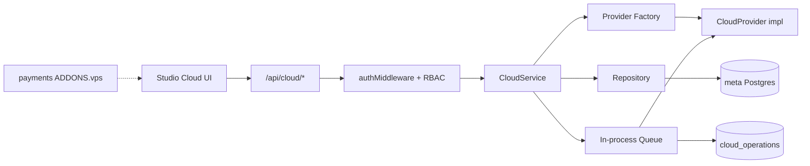
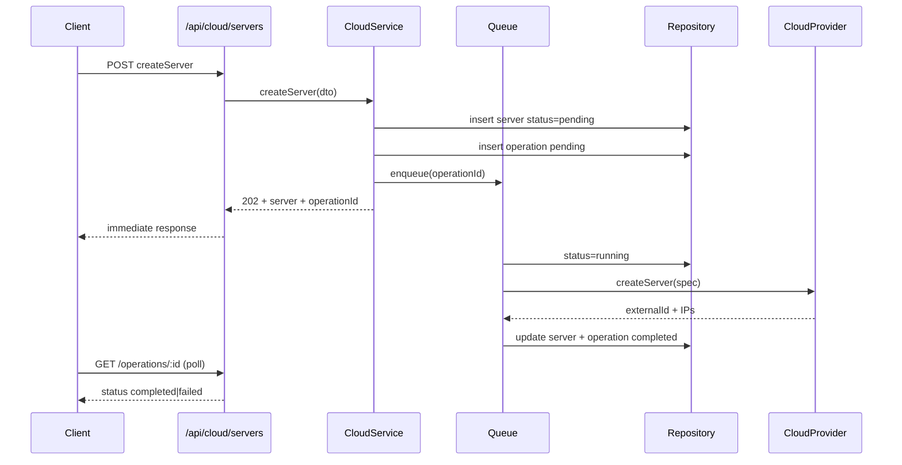

# Cloud Infrastructure — Architecture

Provider-agnostic cloud / VPS module for GraphCore (DBStorages).  
**Does not rewrite** Auth, Billing DB plans, Storage, or Provisioning — it extends them.

## Integration

| Existing module | How Cloud uses it |
|-----------------|-------------------|
| `lib/auth` | Bearer JWT on all cloud routes |
| `lib/rbac` | Tenant / project membership scoping |
| `lib/migrate` | Additive DDL for `cloud_*` tables |
| `payments` | `vps` as **ek hizmet** (contact / studio link); Pro/Scale/Max untouched |
| AppLayout | New **Cloud** sidebar category |

## Layers

1. **Routes** (`routes/cloud.js`) — HTTP, DTO checks, never vendor names in logic  
2. **CloudService** — orchestration, enqueue ops, returns operation id quickly  
3. **Factory** — `providers.slug` → driver instance (DI)  
4. **CloudProvider** — interface (createServer, volumes, firewalls, …)  
5. **HetznerProvider** — only place that talks to `api.hetzner.cloud`  
6. **Repository** — meta DB or in-memory fallback  
7. **Queue** — async worker; persists status on `cloud_operations`

## createServer sequence

## Security

- API keys encrypted at rest (`CLOUD_SECRETS_KEY` or JWT-derived AES-256-GCM)
- Secrets never logged (Bearer redacted in op errors)
- Provider HTTP retries with backoff on 429/5xx
